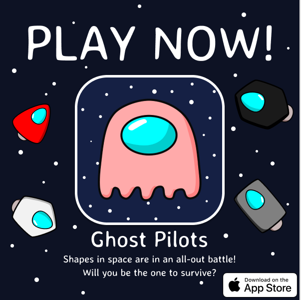
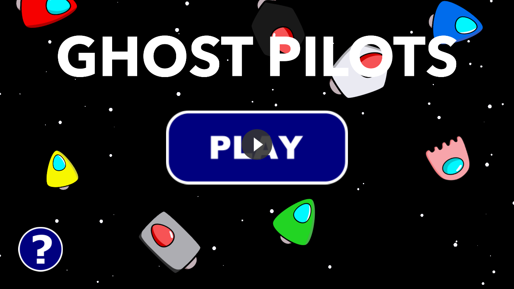
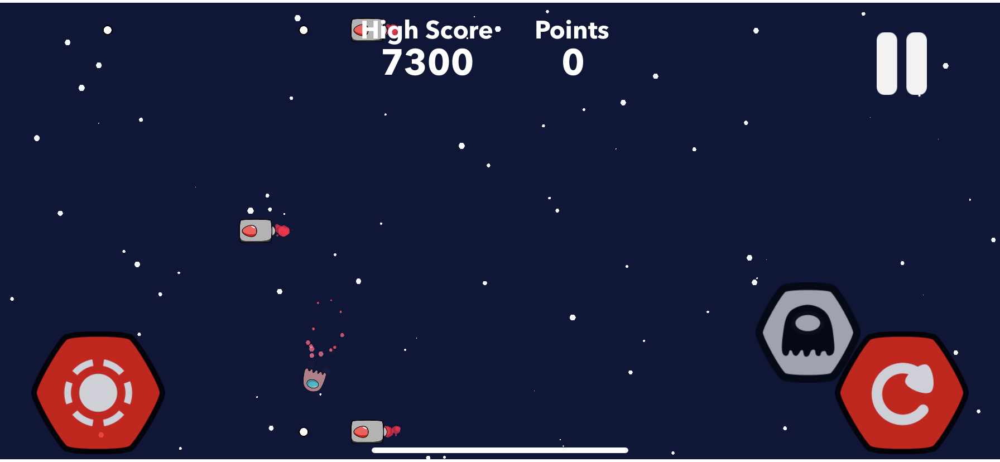
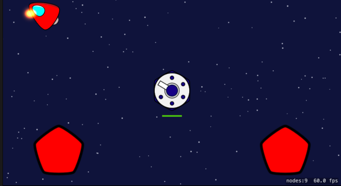

# Ghost Pilots

> Status: the game is being updated for the latest iOS (Firebase, ads, and
> release automation live on the `firebase` branch). The App Store listing is
> temporarily unavailable while that update ships — there is no download link
> here until it is back. See [dhrooby.com/ghostpilots](https://www.dhrooby.com/ghostpilots/)
> for the game's page.

Ghost Pilots is an arcade space shooter for iPhone and iPad: turn, shoot,
survive enemy waves, take on the Turret Boss, chase a high score in Endless
mode, or battle friends online. Lose your ship? Keep fighting as a ghost.

# Version History
* **Version 2.4**

* **Version 2.2**

* **Version 2.0**
  * Sound Effects
  * Better Visuals
  * Better BOSS
  * Bug Fixes

* **Version 1.3**
  * Submitted to the Apple App Store!
  * Added turret boss mode
  * Added the ghost pilot
 
 
* **Version 1.1**
  * Added survive the enemy wave with shooting and collisions!
  * Modified thruster particles to be cleaner and directly on the exhaust instead of the center of the ship
  * Adjusted button size & location
  * Added a main menu with Solo & Online (online is in the works)

* **Version 1.0**

